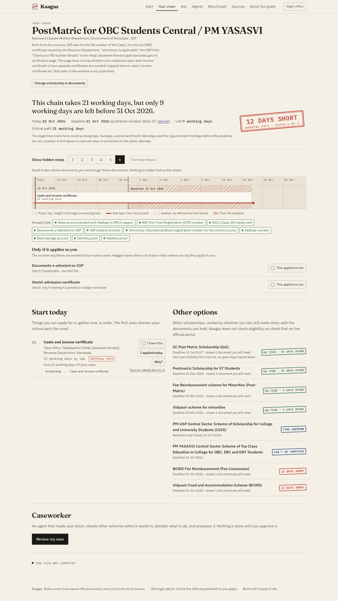

# Kaagaz

> Every scheme finder tells a student what they are eligible for. Kaagaz tells them whether they are already too late, and which certificate to apply for today.

**Track: Track 1, Agents That Act on Connected Data** (Graph Hacks, WeMakeDevs x FalkorDB). Cross-session memory, one graph per student, also touches Track 2.



A government scholarship needs many documents. Some documents need other documents first, each from a different
office, each with a legal processing time. Nobody shows the full chain or adds up the waiting time, so students find
out too late. Kaagaz walks the requirement graph in FalkorDB at every depth, finds the hidden prerequisites, adds up
the legal working days on the longest chain (the critical path), and stamps a verdict against the real deadline.

Example from the real data (17 Oct 2026): a Karnataka student who does not yet hold a caste and income certificate
needs **21 working days** for it (Sakala time limit). PostMatric for OBC Students closes on **31 Oct 2026**, which is
**9 working days** away once Sundays, the fourth Saturday and two government holidays are removed. Kaagaz stamps
**AT LEAST 12 DAYS SHORT** and suggests schemes with later deadlines that reuse the same documents.

## Quick start

Needs Docker.

```bash
git clone https://github.com/Atul-Chahar/kaagaz.git && cd kaagaz
docker compose up -d --build
```

Open http://localhost:8000 and press **Load the Example student**. FalkorDB Browser (it ships in the FalkorDB
container) is at http://localhost:3000; the rules graph is `kaagaz:rules:in-ka-scholarships`.

No API key is needed. Everything works without an LLM; the Ask box then searches names in the graph.

### Local development

```bash
docker compose up -d falkordb          # FalkorDB on localhost:6380, Browser on :3000
bash scripts/seed.sh                   # load the rule pack into the graph
cd backend && uv sync && uv run uvicorn kaagaz.api:app --port 8000
cd frontend && pnpm install && pnpm dev    # http://localhost:5173 (proxies /api to :8000)
bash scripts/verify.sh                 # every check; ends with "VERIFY: ALL CHECKS PASSED"
```

Python 3.12 with uv, Node 22+ with pnpm. All settings are env vars, listed with comments in `.env.example`.

## How the graph does the work

Without FalkorDB there is no product: the chain of documents is a graph, and every answer comes from a Cypher query.

- **Hidden prerequisites:** a variable-length traversal `-[:REQUIRES|OPTION*1..16]->` from the scholarship, filtered
  to the requested depth, returns every document with its full path and the source of each hop. The "Show hidden
  steps" stepper is this query at depth 1, 2, 3 and so on.
- **Critical path:** the planner computes `finish(doc) = days(doc) + max(finish(prerequisite))` over that sub-graph,
  takes the fastest option inside each "any one of" group, and treats held documents as done. `chain_days.cypher`
  computes the same thing for all-of chains in Cypher with `reduce()`, and the two must agree (checked on every plan
  and in the integration tests).
- **Other options:** `shared_documents.cypher` finds schemes that reuse the documents the student still needs.
- **Load-bearing documents:** `load_bearing.cypher` counts how many target schemes each document sits under, and
  `algo.pageRank` over REQUIRES edges gives a second view on the whole pack.
- **Memory:** each student is a separate graph, `kaagaz:student:<id>`. A Cypher query runs on one graph, so the
  planner reads holdings from the student graph and passes the held document ids as a parameter into the rules graph
  query. This is deliberate multigraph isolation: one student's data can never leak into another student's query.

## Graph data model

One shared rules graph per rule pack, `kaagaz:rules:<pack-id>`:

```
(:Pack {id, name, jurisdiction, version, timezone})
(:Scheme {id, name, authority, portal, window_start, window_end, window_year, window_is_last_published, window_renewals_only,
          window_source_url, window_source_title, window_retrieved_at, window_excerpt, window_confidence})
(:Document {id, name, days, days_unit, days_source_url, days_source_title, days_retrieved_at, days_excerpt,
            days_confidence, service_days, validity, office, note})   // days may be null: no official time limit found
(:Office {id, name, level})
(:AnyOf {id, label})                                         // "any one of these documents"
(:Scheme)-[:REQUIRES {source_url, source_title, retrieved_at, excerpt, confidence, note, condition}]->(:Document|:AnyOf)
(:Document)-[:REQUIRES {same}]->(:Document|:AnyOf)
(:AnyOf)-[:OPTION {same}]->(:Document)
(:Office)-[:ISSUES {days, days_source_url, source_url, source_title, retrieved_at, excerpt, confidence}]->(:Document)
```

One graph per student, `kaagaz:student:<student-id>`:

```
(:Student {id, label, created_at})
(:Student)-[:HOLDS]->(:Holding {doc_id, issued_on, added_at})
(:Student)-[:TARGETS]->(:Target {scheme_id, deadline, deadline_source, added_at})
(:Student)-[:PLANNED]->(:PlanSnapshot {at, scheme_id, verdict, critical_days, exact, json})
(:Student)-[:APPLIES]->(:Applies {doc_id, added_at})   // "this conditional requirement applies to me"
```

```
        REQUIRES            REQUIRES                 OPTION
Scheme ─────────> Document ─────────> AnyOf ──────────────> Document ─> ...
                     ^
           ISSUES    |
Office ──────────────┘
```

The scholarship pack: 11 schemes, 41 documents, 10 "any one of" groups, 13 offices, 143 requirement rules.

## Global by design: a second rule pack

The engine knows nothing about India. Countries, processes and calendars live in rule packs (`data/packs/<id>/`).
A second pack, **starting a private limited company in Karnataka** (`in-ka-company`), runs on the same engine, the
same queries and the same UI; switch packs on the Start screen and press **Load the Example founder**.

- 2 goals ("ready to issue GST invoices", "ready to hire staff"), 13 documents, 3 "any one of" groups, 30 rules.
- Legal times found: GST registration 7 working days (CGST Rule 9), Karnataka shops and establishments registration
  7 working days (Sakala), professional tax registration 30 calendar days (Karnataka Tax on Professions Act s.5(3),
  from a secondary copy because the official site was unreachable). No official time was found for MCA
  incorporation (SPICe+), DIN, company PAN and TAN, DSC or the bank account, so those stay unknown.
- Goals have no published deadline: the user sets their own date.
- Units are never mixed. Each document stores `days_unit`. The 30 calendar days for professional tax are converted to
  working days exactly on the sourced Karnataka calendar, starting from the day that step can really begin, and the UI
  shows both ("30 calendar days (20 working days)").

## Cypher queries

Every query the product runs is a parameterized file in `backend/kaagaz/queries/`. The model never writes Cypher.

| Query | What it does |
|---|---|
| [`chain_days.cypher`](backend/kaagaz/queries/chain_days.cypher) | All-of chains only: every REQUIRES path from the scheme through documents the student does not hold, with the remaining legal processing days summed along the path by reduce(). |
| [`document_detail.cypher`](backend/kaagaz/queries/document_detail.cypher) | One document with its issuing office, processing time source, and what it directly requires. |
| [`documents.cypher`](backend/kaagaz/queries/documents.cypher) | Every document in the pack with its office, for the "tick what you hold" list. |
| [`explain.cypher`](backend/kaagaz/queries/explain.cypher) | Why a scheme needs a document: the requirement paths from scheme to document with each hop's source. |
| [`fastest_option.cypher`](backend/kaagaz/queries/fastest_option.cypher) | For one "any one of" group: each option's remaining time, as the longest chain of not-held REQUIRES prerequisites below it (an option is ready only when ALL its own prerequisites are done). |
| [`graph_stats.cypher`](backend/kaagaz/queries/graph_stats.cypher) | Node and edge counts by label and type, for the About page and health check. |
| [`holding_add.cypher`](backend/kaagaz/queries/holding_add.cypher) | Student graph: record a document the student holds (idempotent). |
| [`holding_remove.cypher`](backend/kaagaz/queries/holding_remove.cypher) | Student graph: forget a holding. |
| [`load_bearing.cypher`](backend/kaagaz/queries/load_bearing.cypher) | The document that sits in the prerequisite trees of the most schemes in $scheme_ids (count of distinct schemes per document), skipping documents already held. |
| [`load_bearing_pagerank.cypher`](backend/kaagaz/queries/load_bearing_pagerank.cypher) | PageRank over REQUIRES edges on the whole pack: documents that many requirements point to (directly or through other documents) score highest. |
| [`prerequisites.cypher`](backend/kaagaz/queries/prerequisites.cypher) | Every document and "any one of" group a scheme needs, at every depth up to $depth. |
| [`recall_holdings.cypher`](backend/kaagaz/queries/recall_holdings.cypher) | Student graph: every holding with when it was saved. |
| [`recall_snapshots.cypher`](backend/kaagaz/queries/recall_snapshots.cypher) | Student graph: the most recent saved plans. |
| [`recall_targets.cypher`](backend/kaagaz/queries/recall_targets.cypher) | Student graph: schemes the student targets. |
| [`resolve_name.cypher`](backend/kaagaz/queries/resolve_name.cypher) | Exact, then case-insensitive, lookup of a scheme or document by id or name. |
| [`schemes.cypher`](backend/kaagaz/queries/schemes.cypher) | Every scheme in the pack with its application window, for the Start screen. |
| [`search_names.cypher`](backend/kaagaz/queries/search_names.cypher) | Name search used by the Ask box when no LLM key is set: schemes and documents whose name contains a word. |
| [`seed_anyof.cypher`](backend/kaagaz/queries/seed_anyof.cypher) | Seed: "any one of these documents" groups. |
| [`seed_documents.cypher`](backend/kaagaz/queries/seed_documents.cypher) | Seed: documents. |
| [`seed_indexes.cypher`](backend/kaagaz/queries/seed_indexes.cypher) | Seed: id indexes (one statement per line, run one by one). |
| [`seed_issues.cypher`](backend/kaagaz/queries/seed_issues.cypher) | Seed: ISSUES edges (office issues document), with the legal days and the source for the office. |
| [`seed_offices.cypher`](backend/kaagaz/queries/seed_offices.cypher) | Seed: issuing offices. |
| [`seed_option.cypher`](backend/kaagaz/queries/seed_option.cypher) | Seed: OPTION edges (an AnyOf group can be met by this document), each with its source. |
| [`seed_pack.cypher`](backend/kaagaz/queries/seed_pack.cypher) | Seed: the pack node. |
| [`seed_requires.cypher`](backend/kaagaz/queries/seed_requires.cypher) | Seed: REQUIRES edges (scheme or document needs a document or an AnyOf group), each with its source. |
| [`seed_schemes.cypher`](backend/kaagaz/queries/seed_schemes.cypher) | Seed: schemes with their application window and the source that proves it. |
| [`shared_documents.cypher`](backend/kaagaz/queries/shared_documents.cypher) | Other schemes whose requirement trees (any depth) reuse documents this student still needs. |
| [`snapshot_add.cypher`](backend/kaagaz/queries/snapshot_add.cypher) | Student graph: remember a computed plan, so a later visit can say what changed. |
| [`source_usage.cypher`](backend/kaagaz/queries/source_usage.cypher) | How many rules in the graph cite each source URL (edges, processing times, windows). |
| [`student_get.cypher`](backend/kaagaz/queries/student_get.cypher) | Student graph: the student node. |
| [`student_init.cypher`](backend/kaagaz/queries/student_init.cypher) | Student graph: create the student node once (each student has a separate graph kaagaz:student:<id>). |
| [`target_set.cypher`](backend/kaagaz/queries/target_set.cypher) | Student graph: the scheme the student is applying for, with the deadline they plan against. |

FalkorDB notes that shaped these queries (tested, see `docs/notes/FALKORDB_NOTES.md`): a parameter cannot be the
upper bound of a variable-length pattern, so the bound is the literal `16` (twice the maximum depth of 8) and
`$depth` filters the paths; label unions like `(n:A|B)` are not supported, so queries use `WHERE n:A OR n:B`;
relationship aliases are always bound; and the default 1 second query timeout is raised per query.

`algo.SPpaths` is not used for "fastest option": it returns the shortest chain under an option, but an option is
ready only when all of its own prerequisites are done, so `fastest_option.cypher` takes the longest chain per option
and then the smallest option. Every plan runs it for each open "any one of" group as a cross-check of the planner's
choice (shown under "How this was computed"); the integration tests require them to agree.

## The agent and its tools

The only things the agent (or the UI, or MCP) can call, each with validated arguments:
`resolve(name)`, `prerequisites(scheme_id, depth<=8)`, `plan(student_id, scheme_id)`, `explain(scheme_id, doc_id)`,
`alternatives(student_id, scheme_id)`, `remember_holding(student_id, doc_id, issued_on)`, `recall(student_id)`.

- Names are checked against the graph (`resolve_name.cypher`) before any other query runs.
- Every answer has one of five outcomes, shown in the UI: **answered with a path**, **answered from memory**,
  **not in the graph**, **unknown name**, **no official time found**.
- Every tool call and query is logged as a trace row (tool, arguments, milliseconds, rows) and shown.
- Optional LLM layer (`LLM_PROVIDER` = `anthropic` or any OpenAI-compatible endpoint): the model picks one tool and
  writes one sentence. The sentence is checked: every scheme or document name it mentions and every number it states
  must be in the tool result, otherwise the sentence built from the result is shown instead.

### MCP server

The same seven tools over MCP. With FalkorDB running:

```bash
claude mcp add kaagaz -- uv --directory /path/to/kaagaz/backend run python -m kaagaz.mcp_server
```

For Cursor, add to `.cursor/mcp.json`:

```json
{ "mcpServers": { "kaagaz": { "command": "uv",
  "args": ["--directory", "/path/to/kaagaz/backend", "run", "python", "-m", "kaagaz.mcp_server"] } } }
```

## Benchmark

`bench/questions.jsonl` has 29 questions (7 "list every document", 9 "what to apply for first", 13 "can a student
holding X make a deadline N working days away"). A subagent wrote the questions and the ground truth from the saved
source texts only, without reading the graph or the pack. **The graph and the ground truth come from the same
sources**, so this is a test of reading the sources the same way, not an outside benchmark.

Three systems use the same model: the model alone, plain RAG (BM25 over the same saved source text, top 8 chunks,
then the model), and Kaagaz (the model picks one tool, the answer is read from the tool result). Metrics: document
recall, invented documents per answer, verdict accuracy, first-step accuracy. `make bench` writes
`bench/results/<timestamp>.json` with model name, date and raw answers.

**Latest LLM run: not run.** No LLM key was available while building, so there are no three-system numbers. The
Benchmark page says "Benchmark not run yet. Add an LLM key and run `make bench`." until a real run exists.

**Kaagaz planner on its own (no LLM, `make bench-deterministic`), 17 Oct 2026:** document recall 93%, 1.43 invented
documents per answer, verdict accuracy 92% (12 of 13), first-step accuracy 33% (3 of 9). The results file lists all 13
disagreements with both answers. They come from which income or caste certificate a scheme's source names (a generic
one or the Karnataka one), from "first step" questions where no official time limit decides the order, and from rules
that apply only to some students (Kaagaz leaves those out unless the student says they apply, and the benchmark does
not say). These numbers are shown as they came out; the planner was not tuned to the questions. An earlier run, before
conditional rules were handled, is kept in `bench/results/` too.

## Data and integrity rules

- Sources: the National Scholarship Portal, the Karnataka State Scholarship Portal and department pages, the Karnataka
  Sakala compendium of time limits (05-05-2026), the Karnataka 2026 holiday notification, UIDAI, RBI, NPCI and
  district NIC pages, plus MCA, CBIC/GST, Labour and professional tax sources for the company pack. 60 saved sources,
  each with a SHA-256 hash, listed on the Sources page and in
  `data/sources/index.json`. Files over 5 MB stay out of git (hash and extracted text are kept).
- Every rule (requirement edge, processing time, application window, issuing office, holiday) stores
  `source_url`, `source_title`, `retrieved_at`, an `excerpt` of 25 words or fewer, and `confidence`
  (`official` or `secondary`). `scripts/audit_data.py` fails the build if any field is missing, any URL is not in the
  index, any excerpt is not found in the saved text, or any saved file's hash changed.
- If no official processing time exists, `days` is `null`. The planner never guesses: a verdict that depends on an
  unknown step is a lower bound ("AT LEAST 21 DAYS") or "can't be computed".
- Sakala limits are working days. Kaagaz counts working days to the deadline using the official 2026 holiday list and
  the Sundays plus second and fourth Saturdays rule. The 2027 list is not out, so for January 2027 deadlines the UI
  warns that the count may be slightly high.
- The Example student (and the Example founder in the company pack) is synthetic and labelled everywhere. Each
  visitor gets a private copy. No personal data is stored except what a user ticks, in their own graph, which they
  can delete (`DELETE /api/students/<id>`).

How the pack was built: research subagents saved sources with `scripts/fetch_source.py` (robots.txt, 1 request per
second per site, cache) and wrote fragments in `data/research/`; `scripts/build_pack.py` turns them into
`data/packs/in-ka-scholarships/pack.yaml`. See `docs/FEASIBILITY.md`.

## Limitations (honest list)

- Most full-depth verdicts are lower bounds, because many steps (proof of residence, bank account, Aadhaar seeding,
  NSP registration) have no official time limit.
- Eligibility (category, income limit, marks) is not modelled. Rules that apply only to some students ("only if you
  live in a hostel", "only for reserved categories") are left out of the chain until the student says "This applies
  to me"; that choice is saved in their own graph. Conditions true for everyone a pack models (a regular degree
  student) are listed in the pack as assumptions.
- One scheme (CSSS) has a 2026-27 window for renewals only. Kaagaz models a fresh application, so it shows "no
  fresh-application window" for it instead of planning against the renewal date.
- The "address proof" and "ID proof" steps for Karnataka certificates are categories: the sources do not list which
  documents count, so Kaagaz cannot give a time for them and says so.
- Karnataka requirement lists for Nadakacheri certificates come from Tumakuru district NIC pages; the state-wide list
  is a scanned Kannada image the audit cannot read.
- Two sources are secondary and tagged in the UI: an SSP e-attestation FAQ hosted by Mangalore University, and the
  PRS copy of the Karnataka Tax on Professions Act (the official sites were unreachable).
- GST registration's 7 working days assume Aadhaar authentication; Rule 9 allows up to thirty days otherwise. The
  Why panel says so.
- Legal time limits are maximums; real offices can be faster or slower. Kaagaz plans against the legal limit.
- No live deployment yet (no cloud credentials were available); `docs/DEPLOY.md` has the steps.
- The three-system LLM benchmark has not been run (no key).

## Tests

`bash scripts/verify.sh` runs, in order: FalkorDB start, seed, data audit, lint, unit tests (planner maths, deadline
edge cases, tool argument validation, sentence checker, benchmark scorer, audit failure cases), integration tests
against real FalkorDB (every query file, `chain_days.cypher` vs the planner on more than 100 cases, student graph
isolation, memory surviving an API restart, MCP), frontend typecheck, lint and build, Playwright end-to-end tests
(depth stepping matches the API at every depth, "I have this" recomputes, Why panel source link, Ask without a key,
honest Benchmark page, keyboard use, no sideways scroll at 390 px), axe accessibility checks on every screen,
screenshots at 1440 and 390 px in light and dark (`docs/screenshots/`), and the Docker image build.

## Repository map

```
backend/kaagaz/    api.py graph.py tools.py planner.py workdays.py memory.py agent.py mcp_server.py queries/*.cypher
backend/tests/     unit + integration tests
data/packs/        rule packs (pack.yaml is generated; meta.yaml holds the Example student and display groups)
data/research/     sourced research fragments        data/sources/  index.json, text/, raw/ (saved sources)
frontend/          Vite + React + TypeScript, hand-written CSS with design tokens
e2e/               Playwright + axe tests and screenshot capture
bench/             questions, runner, results        scripts/  verify.sh seed.sh audit_data.py build_pack.py
docs/              FEASIBILITY, DEMO_SCRIPT, BLOG_DRAFT, SUBMISSION, DEPLOY, DESIGN_REVIEW, screenshots/
```

## Licence

Code: MIT (see `LICENSE`). Saved government sources keep their own terms.

## AI disclosure

Built with Claude Code (Anthropic). I designed the idea, reviewed the code and verified the results.

Research subagents found and saved the sources; every rule they wrote is checked automatically against the saved text.
