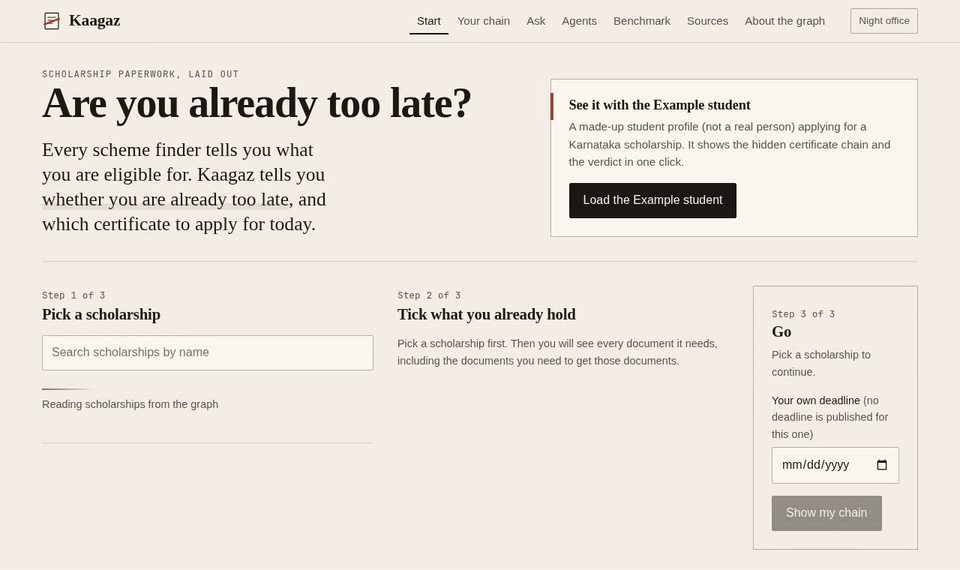
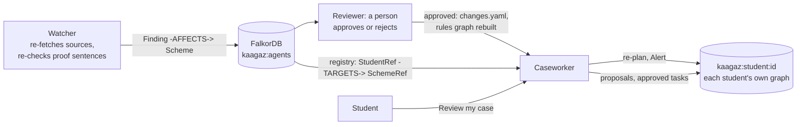
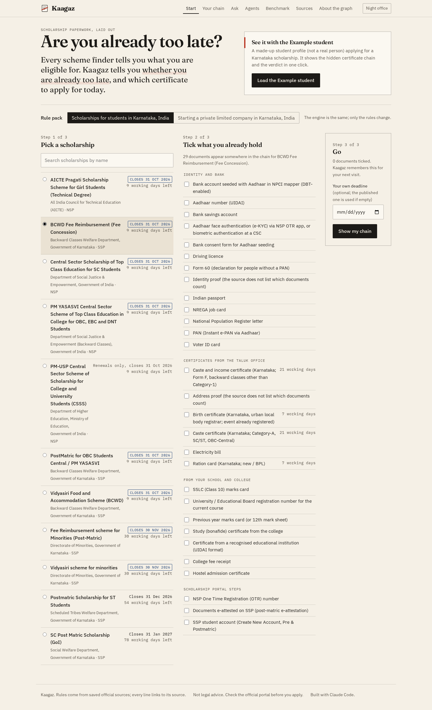
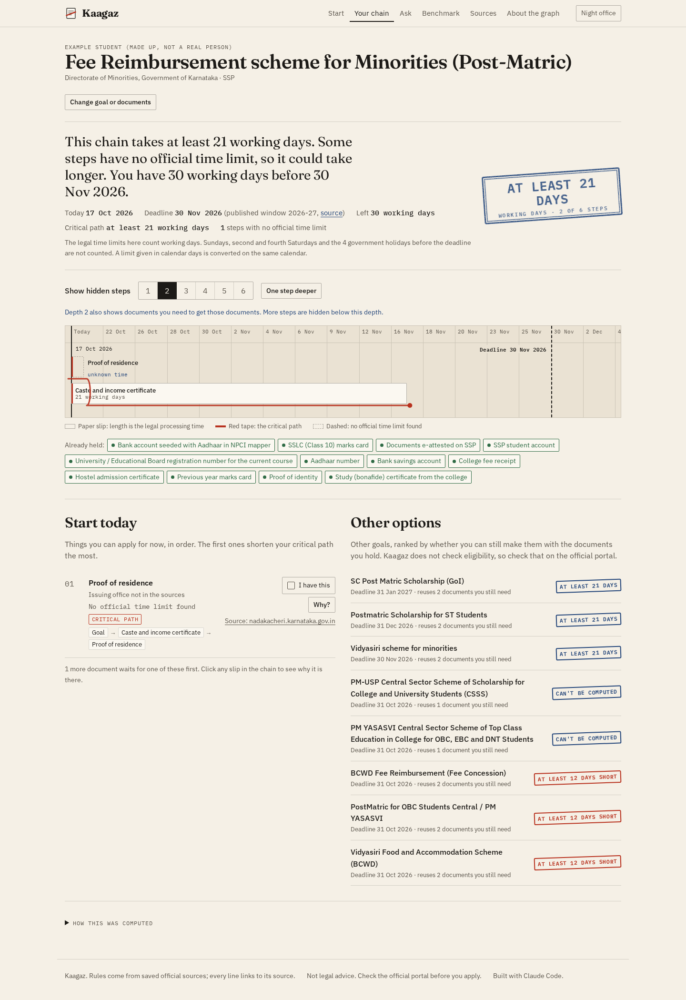
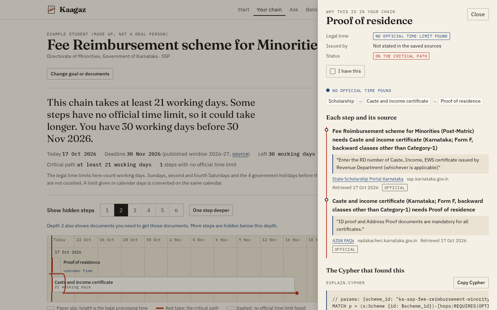
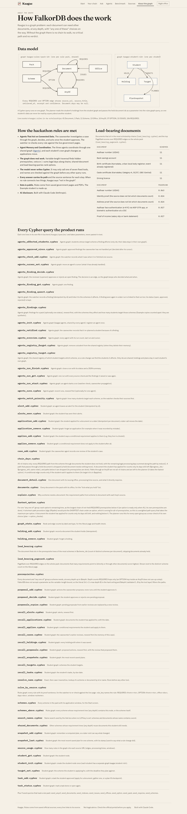
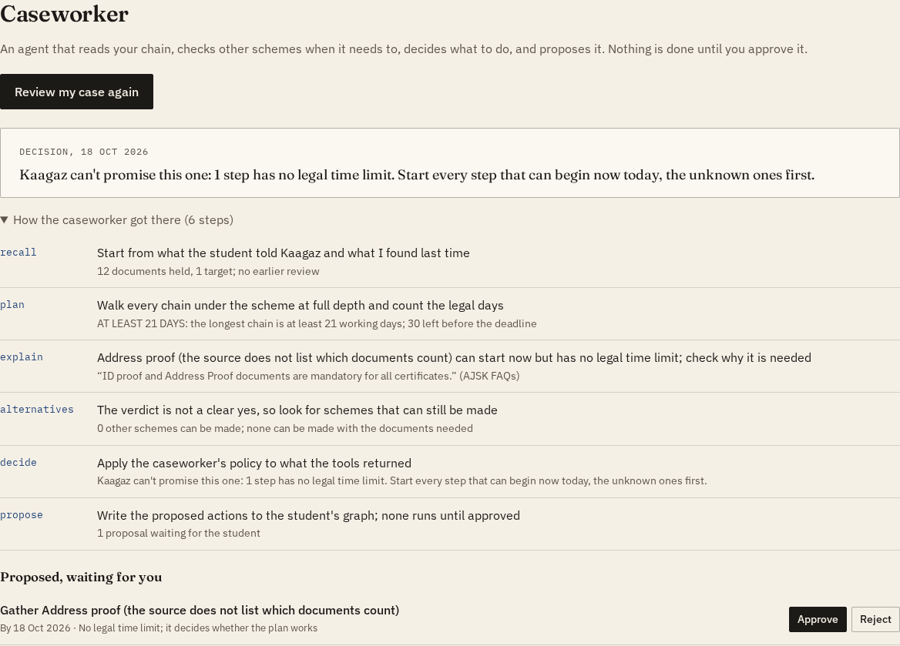
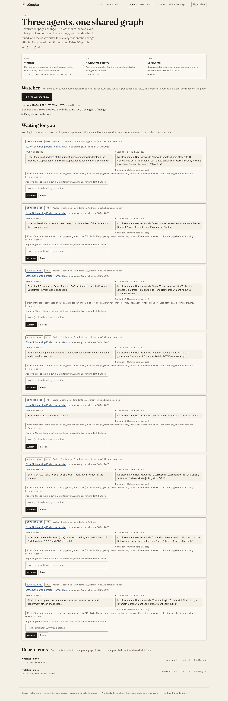
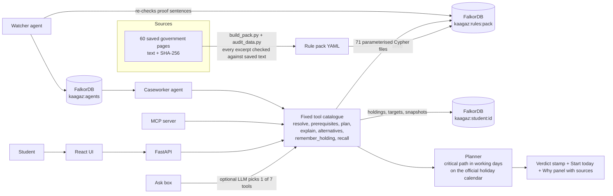

# Kaagaz

> Every scheme finder tells a student what they are eligible for. Kaagaz tells them whether they are already too
> late, and which certificate to apply for today.

[](https://github.com/Atul-Chahar/kaagaz/actions/workflows/ci.yml)


**[Demo video](https://drive.google.com/file/d/1O2tQ376d4i9ojpo3L3ipvYGz6F57Pmp9/view?usp=sharing)** · **[Run it in 60 seconds](#run-it-in-60-seconds)** · **[The agents](#the-agents)** ·
**[How FalkorDB is used](#how-falkordb-is-used)** · **[Graph data model](#graph-data-model)** ·
**[Cypher queries](#the-cypher-the-product-depends-on)** · **[Proof you can check](#proof-you-can-check)** ·
**[Questions judges ask](#questions-judges-ask)**

**Graph Hacks (WeMakeDevs x FalkorDB).** Tracks: **Agents That Act on Connected Data** (a caseworker agent
investigates a student's case through the graph, decides, and acts after approval; a watcher agent re-checks the rules
against the live government pages) and **Agent Memory and Coordination** (three agents coordinate through one shared
FalkorDB graph, and each student's own memory graph changes as their applications move).


## The problem

A government scholarship in India needs documents. Many of those documents need other documents first, each from a
different office, each with its own legal processing time. Scholarship portals list what to upload. Nobody shows the
whole chain or adds up the waiting time, so students find out they are too late after the window has closed.

A real example from the data: a Karnataka student who does not yet hold a caste and income certificate needs
**21 working days** for it (the Sakala legal time limit). Post Matric for OBC Students closes on **31 Oct 2026**,
which was **9 working days** away on 18 Oct 2026 once Sundays, the fourth Saturday and two government holidays are
removed. Kaagaz stamps **12 DAYS SHORT** and lists schemes with later deadlines that reuse the same certificate.

## What Kaagaz does

1. **Finds hidden steps.** It walks the requirement graph in FalkorDB at every depth: scholarship, then the documents
   it asks for, then the documents those need, and so on. The "Show hidden steps" control is that walk, one depth at
   a time.
2. **Adds up the legal time on the longest chain** (the critical path), in working days on the official Karnataka
   holiday calendar.
3. **Stamps a verdict** against the real deadline: `ON TIME · 9 DAYS SPARE`, `AT LEAST 21 DAYS`, `12 DAYS SHORT`.
4. **Says what to apply for today**, and which other schemes reuse the same documents.
5. **Remembers each student** in their own graph, so "I have this" survives a reload and the plan updates.
6. **Never guesses.** A step with no official time stays unknown and the verdict becomes "at least". Every rule
   carries the exact sentence from its government source, shown in the Why panel with a link and the saved date.
7. **Has agents that act and remember.** A caseworker reviews a case and proposes what to do, a watcher checks
   whether the government pages still say what the rules quote, and both work through a shared graph.

## The agents

Three agents share one FalkorDB graph, `kaagaz:agents`. Each keeps a record of its own work there, and they hand work
to each other through it.





| Agent | What it does | What it writes |
|---|---|---|
| **Watcher** | Fetches each saved government source again (robots.txt respected, one request per second per site) and looks for every rule's exact proof sentence on the live page. When a sentence is gone, it finds the closest one on the new page with the digits masked and says whether a date changed, a number changed, the wording changed, or the sentence is gone. Sources behind schemes that students target are checked first. | `(:Run)-[:CHECKED]->(:SourceCheck)`, `(:Run)-[:FOUND]->(:Finding)-[:AFFECTS]->(:SchemeRef)` |
| **Reviewer** (a person) | Approves or rejects each finding on the **Agents** screen. Nothing in the rules changes before that. On approval, the re-fetched copy is saved as a new source version, the change goes into `data/packs/<pack>/changes.yaml` (audited like every other rule), and the rules graph is rebuilt. | `(:Agent {id: 'reviewer'})-[:DECIDED]->(:Finding)` |
| **Caseworker** | After an approval, follows the registry to every student who targets an affected scheme, re-plans each one, and leaves an alert in that student's own graph. A cursor on its node means each approval is handled once. On request, it reviews one student's case (below). | `(:Agent)-[:NOTIFIED]->(:Finding)`; in the student's graph `(:Alert)`, `(:CaseReview)-[:PROPOSED]->(:Proposal)`, `(:Task)` |

**The caseworker's loop.** "Review my case" calls the same tools the Ask box uses, and each step depends on what the
last one returned: `recall` (what the student holds, and the caseworker's own last review), then `plan` (critical
path and verdict), then `explain` for each step that can start now but has no legal time, then `alternatives`, but
only when the verdict is not a clear yes. Then it decides with a written policy, so the decision can be tested:

- On time: apply for each step that can start now by the latest date that keeps the spare days.
- Time unknown: start the steps with no legal time first, because they decide whether the plan works.
- Short: apply today anyway, since offices can be faster than the limit, and keep a plan B that reuses the same
  documents, with a checkpoint on the deadline.
- Window closed: switch to the best scheme that can still be made.

It proposes tasks with due dates, a plan-B checkpoint, or a switch of target. **None of them runs until the student
presses Approve.** After acting it plans again, so the student sees the effect, and an approved task can go into a
calendar file. If an LLM key is set, the model writes a short case note, which must pass the same sentence checker as
the Ask box.

**Memory that changes over time.**
- An application counts down. Press "I applied today", or tick an approved "apply for" task as done, and that step's
  remaining time becomes its legal limit minus the working days since the application. The planner and both Cypher
  cross-checks (`chain_days`, `fastest_option`) apply the same countdown, and the integration tests make them agree
  on more than 300 cases.
- Each review is compared with the caseworker's previous one: working days passed, how the stamp moved, and what the
  student got or applied for since.
- Alerts from an approved rule change wait in the student's graph until they are read.

**First real run, 18 Oct 2026** ([`docs/watch/latest.md`](docs/watch/latest.md)). The watcher checked the 22 saved
sources behind the 175 rules of the scholarship pack. 18 had the same text and 3 had changed; the 74 MB Sakala
compendium was skipped as too large (`--include-large` checks it). Every application deadline sentence was still on
its page. The 8 findings all come from the SSP home page, which no longer shows the application steps that 48 rules
quote. Because most of that page changed at once, the watcher warns that the steps may have moved to a section loaded
by script. The findings are left open for a person to decide.

## Demo video

**[Watch the demo](https://drive.google.com/file/d/1O2tQ376d4i9ojpo3L3ipvYGz6F57Pmp9/view?usp=sharing)**: the Example student, the hidden steps appearing depth by depth, the Why panel
with its source sentence and Cypher, the student's memory surviving a reload, and the same query run in FalkorDB
Browser.

## Run it in 60 seconds

There is no live deployment. Everything runs locally with one command (needs Docker):

```bash
git clone https://github.com/Atul-Chahar/kaagaz.git && cd kaagaz && docker compose up -d --build
```

Then open http://localhost:8000:

1. Press **Load the Example student** (a made-up student, labelled everywhere). Green stamp at depth 1.
2. Press **One step deeper**. A hidden prerequisite appears and the stamp turns blue: **AT LEAST 21 DAYS**.
3. Click any slip. The Why panel shows the exact sentence from the government source, its link and saved date, and
   the Cypher query that produced the answer, with **Open in FalkorDB Browser** (http://localhost:3000; the rules
   graph is `kaagaz:rules:in-ka-scholarships`).
4. Press **I have this** on a step under **Start today**, then reload. The plan is recomputed from the student's own
   graph and the change is still there. **I applied today** starts that step's countdown instead.
5. Under **Caseworker**, press **Review my case**. You see each tool it called, its decision and its proposals.
   Approve one and it becomes a task, with a calendar file.
6. Open **Agents**: the watcher's last run over the live government pages, and what it found, waiting for a person to
   approve or reject.

**Opening this after 18 Oct 2026?** Kaagaz counts from today, and 7 of the 11 scholarship windows close on
31 Oct 2026. A bar under the menu then offers **See it as on 18 Oct 2026**, the submission day. Only the start date
moves; the rules and deadlines are the real ones, the bar stays visible while it is on, and plans viewed this way
are not saved to the student's memory. (API: send `X-Kaagaz-As-Of: 2026-10-18` or add `?as_of=2026-10-18`.)

No API key is needed. With one (any OpenAI-compatible or Anthropic key), the Ask box also takes free-text questions.

## Screens

| | |
|---|---|
|  **Start.** Pick a scholarship, tick what you already hold, or load the Example student. |  **Show hidden steps.** Each depth is the same traversal with a larger bound. Red tape marks the critical path. |
|  **Why panel.** Every hop with its source sentence, link, date and confidence. |  **About the graph.** Data model, live counts, load-bearing documents (PageRank) and every query file. |

|  **Caseworker.** Each tool call it made and why, the decision, and actions that wait for your approval. |  **Agents.** The watcher's run over the live government pages, and each finding with the old and new sentence. |

Every screen in light and dark, at 1440 and 390 px, is in [`docs/screenshots/`](docs/screenshots/).

## Hackathon requirements, and where they are met

| Requirement | Where |
|---|---|
| FalkorDB is the primary database and central to the product | Every answer is a Cypher query over the rules graph plus a per-student graph: [How FalkorDB is used](#how-falkordb-is-used) |
| Public repository | This repository, MIT licence |
| README with setup instructions and the graph data model | [Run it in 60 seconds](#run-it-in-60-seconds), [Local development](#local-development), [Graph data model](#graph-data-model) |
| The Cypher queries the product depends on | [The Cypher the product depends on](#the-cypher-the-product-depends-on): 71 parameterised files in [`backend/kaagaz/queries/`](backend/kaagaz/queries/), the three central ones shown in full |
| Demo video | [Demo video](https://drive.google.com/file/d/1O2tQ376d4i9ojpo3L3ipvYGz6F57Pmp9/view?usp=sharing) |
| Live deployment, or complete local setup | No live deployment. One Docker command starts FalkorDB, FalkorDB Browser and the app; [`docs/DEPLOY.md`](docs/DEPLOY.md) has deployment steps |
| Track | Agents That Act on Connected Data, and Agent Memory and Coordination: [The agents](#the-agents) |
| Only public, synthetic or own data | 60 public government sources in [`data/sources/index.json`](data/sources/index.json), each with a SHA-256 hash; the Example student is synthetic |
| AI tools disclosed | [How this was built, and AI disclosure](#how-this-was-built-and-ai-disclosure) |
| New work during the event | Full commit history: first commit 17 Oct 2026, inside the 15 to 18 Oct event |

## How FalkorDB is used

Kaagaz is a graph problem: each document can need other documents, at any depth, with "any one of these" choices on
the way. Take FalkorDB away and there is no chain to walk, no critical path and no verdict.

| FalkorDB feature | What Kaagaz does with it | Where |
|---|---|---|
| Variable-length traversal over two edge types, `-[:REQUIRES\|OPTION*1..16]->` | Finds every hidden prerequisite with its full path; the depth stepper filters the same query by REQUIRES hops | [`prerequisites.cypher`](backend/kaagaz/queries/prerequisites.cypher) |
| Path functions, `reduce()` and list predicates (`none`, `all`, `any`) over `nodes(p)` | Sums the legal days along every all-of chain inside the database, drops chains through documents already held, and counts a conditional rule only if the student said it applies | [`chain_days.cypher`](backend/kaagaz/queries/chain_days.cypher) |
| Many graphs in one instance | One shared rules graph per rule pack, and one separate memory graph per student (`kaagaz:student:<id>`). A query runs on one graph, so one student's data can never reach another student's query | [`memory.py`](backend/kaagaz/memory.py), [`student_init.cypher`](backend/kaagaz/queries/student_init.cypher) |
| `algo.pageRank` | Ranks "load-bearing" documents: the ones most requirements depend on, directly or through other documents | [`load_bearing_pagerank.cypher`](backend/kaagaz/queries/load_bearing_pagerank.cypher) |
| Properties on edges | Every REQUIRES, OPTION and ISSUES edge stores `source_url`, `source_title`, `retrieved_at`, the exact `excerpt` and `confidence`, so every answer can show its proof | [`seed_requires.cypher`](backend/kaagaz/queries/seed_requires.cypher) |
| One shared graph for agent coordination | Runs, source checks, findings, decisions and a registry of which student targets which scheme live in `kaagaz:agents`. The caseworker finds who a change affects with one pattern, `(f:Finding)-[:AFFECTS]->(:SchemeRef)<-[:TARGETS]-(:StudentRef)` | [`agents_affected_students.cypher`](backend/kaagaz/queries/agents_affected_students.cypher) |
| `MERGE` and `FOREACH` for idempotent writes | A finding seen again is linked to the new run instead of duplicated, and keeps its decision | [`agents_finding_upsert.cypher`](backend/kaagaz/queries/agents_finding_upsert.cypher) |
| List comprehensions over parameter lists inside `reduce()` | The countdown for applications in progress, computed in the database for the cross-check | [`chain_days.cypher`](backend/kaagaz/queries/chain_days.cypher) |
| Parameterised queries and read-only queries (`GRAPH.RO_QUERY`) | All 71 query files are fixed files with parameters, run read-only unless they write memory or seed a pack; the model never writes Cypher | [`graph.py`](backend/kaagaz/graph.py) |
| Indexes | `id` indexes on Scheme, Document, AnyOf and Office | [`seed_indexes.cypher`](backend/kaagaz/queries/seed_indexes.cypher) |
| Per-query timeout | Set explicitly on every query (the default is 1 second) | [`graph.py`](backend/kaagaz/graph.py) |
| FalkorDB Browser (ships in the same image) | Every Why panel shows its Cypher with **Open in FalkorDB Browser**, so a judge can run it and get the same rows | [`WhyPanel.tsx`](frontend/src/components/WhyPanel.tsx) |

**Two answers, one check.** The Python planner computes `finish(doc) = days(doc) + max(finish(prerequisite))` over
the sub-graph, takes the fastest option inside each "any one of" group and treats held documents as done.
`chain_days.cypher` computes the all-of chains in Cypher, and `fastest_option.cypher` ranks each "any one of" group
in Cypher. Every plan runs both and shows whether they agree ("How this was computed"); the integration tests compare
them on more than 100 cases.

**What FalkorDB taught us** (tested, see [`docs/notes/FALKORDB_NOTES.md`](docs/notes/FALKORDB_NOTES.md)): a parameter
cannot be the upper bound of a variable-length pattern, so the bound is the literal `16` (twice the maximum depth of
8) and `$depth` filters the paths; label unions like `(n:A|B)` are not supported, so queries use `WHERE n:A OR n:B`;
and the default 1 second query timeout is raised per query. `algo.SPpaths` is not used for "fastest option": it
returns the shortest chain under an option, but an option is ready only when all of its own prerequisites are done,
so `fastest_option.cypher` takes the longest chain per option and then the smallest option.

## Architecture



The model never writes Cypher. Names are resolved against the graph before any other query runs, and every tool call
and query is logged as a trace row shown in the UI.

## Graph data model

One shared rules graph per rule pack, `kaagaz:rules:<pack-id>`:

```
(:Pack {id, name, jurisdiction, version, timezone})
(:Scheme {id, name, authority, portal, window_start, window_end, window_year, window_is_last_published, window_renewals_only,
          window_source_url, window_source_title, window_retrieved_at, window_excerpt, window_confidence})
(:Document {id, name, days, days_unit, days_source_url, days_source_title, days_retrieved_at, days_excerpt,
            days_confidence, service_days, validity, office, note})   // days may be null: no official time limit found
(:Office {id, name, level})
(:AnyOf {id, label})                                         // "any one of these documents"
(:Scheme)-[:REQUIRES {source_url, source_title, retrieved_at, excerpt, confidence, note, condition}]->(:Document|:AnyOf)
(:Document)-[:REQUIRES {same}]->(:Document|:AnyOf)
(:AnyOf)-[:OPTION {same}]->(:Document)
(:Office)-[:ISSUES {days, days_source_url, source_url, source_title, retrieved_at, excerpt, confidence}]->(:Document)
```

One graph per student, `kaagaz:student:<student-id>`:

```
(:Student {id, label, created_at})
(:Student)-[:HOLDS]->(:Holding {doc_id, issued_on, added_at})
(:Student)-[:TARGETS]->(:Target {scheme_id, deadline, deadline_source, added_at})
(:Student)-[:PLANNED]->(:PlanSnapshot {at, scheme_id, verdict, critical_days, exact, json})
(:Student)-[:APPLIES]->(:Applies {doc_id, added_at})   // "this conditional requirement applies to me"
```

Each student graph also holds what the agents leave there:

```
(:Student)-[:APPLIED]->(:Application {doc_id, applied_on, added_at})           // counts the step down
(:Student)-[:REVIEWED]->(:CaseReview {id, at, today, scheme_id, verdict, stamp, decision, json})
(:CaseReview)-[:PROPOSED]->(:Proposal {id, kind, title, reason, doc_id, scheme_id, due, status})
(:Student)-[:HAS_TASK]->(:Task {id, kind, title, due, status, from_proposal})
(:Student)-[:ALERTED]->(:Alert {id, at, kind, scheme_id, finding_id, message, before, after, seen})
```

One shared agents graph, `kaagaz:agents`:

```
(:Agent {id, name, role, cursor})-[:RAN]->(:Run {id, agent, pack, started_at, finished_at, status, trigger, summary})
(:Run)-[:CHECKED]->(:SourceCheck {source_id, url, status, rules_checked, rules_missing, new_sha256, warning})
(:Run)-[:FOUND]->(:Finding {id, kind, rule_keys, source_url, old_excerpt, new_excerpt, new_value, status})
(:Finding)-[:AFFECTS]->(:SchemeRef {key, pack, id})<-[:TARGETS]-(:StudentRef {id})   // ids only
(:Agent {id: 'reviewer'})-[:DECIDED {at, status}]->(:Finding)
(:Agent {id: 'caseworker'})-[:NOTIFIED {at, student_id, before, after}]->(:Finding)
```

```
        REQUIRES            REQUIRES                 OPTION
Scheme ─────────> Document ─────────> AnyOf ──────────────> Document ─> ...
                     ^
           ISSUES    |
Office ──────────────┘
```

The scholarship pack: 11 schemes, 41 documents, 10 "any one of" groups, 13 offices, 143 requirement rules
(106 REQUIRES and 37 OPTION edges).

### Global by design: a second rule pack

The engine knows nothing about India. Countries, processes and calendars live in rule packs (`data/packs/<id>/`).
A second pack, **starting a private limited company in Karnataka** (`in-ka-company`), runs on the same engine, the
same queries and the same UI; switch packs on the Start screen and press **Load the Example founder**.

- 2 goals ("ready to issue GST invoices", "ready to hire staff"), 13 documents, 3 "any one of" groups, 30 rules.
- Legal times found: GST registration 7 working days (CGST Rule 9), Karnataka shops and establishments registration
  7 working days (Sakala), professional tax registration 30 calendar days (Karnataka Tax on Professions Act s.5(3),
  from a secondary copy because the official site was unreachable). No official time was found for MCA
  incorporation (SPICe+), DIN, company PAN and TAN, DSC or the bank account, so those stay unknown.
- Goals have no published deadline: the user sets their own date.
- Units are never mixed. Each document stores `days_unit`. The 30 calendar days for professional tax are converted to
  working days exactly on the sourced Karnataka calendar, starting from the day that step can really begin, and the UI
  shows both ("30 calendar days (20 working days)").

## The Cypher the product depends on

Every query the product runs is a parameterised file in [`backend/kaagaz/queries/`](backend/kaagaz/queries/). The
three below do the central work.

**Hidden prerequisites at any depth** ([`prerequisites.cypher`](backend/kaagaz/queries/prerequisites.cypher)):

```cypher
MATCH p = (s:Scheme {id: $scheme_id})-[hops:REQUIRES|OPTION*1..16]->(n)
WITH p, n, size([r IN relationships(p) WHERE type(r) = 'REQUIRES']) AS depth
WHERE depth <= $depth
WITH p, n, depth, relationships(p) AS rs
OPTIONAL MATCH (o:Office)-[iss:ISSUES]->(n)
RETURN n.id AS id, labels(n)[0] AS label, n.name AS name, n.days AS days, depth,
       [x IN nodes(p) | x.id] AS path,
       [r IN rs | type(r)] AS hop_types,
       properties(rs[size(rs) - 1]) AS hop,
       size([(n)-[more:REQUIRES]->(m) | m.id]) AS out_requires,
       properties(n) AS props,
       o.id AS office_id, o.name AS office_name, properties(iss) AS issues
ORDER BY depth, id
```

**Legal days along each chain, in the database** ([`chain_days.cypher`](backend/kaagaz/queries/chain_days.cypher)):

```cypher
MATCH p = (s:Scheme {id: $scheme_id})-[hops:REQUIRES*1..8]->(leaf:Document)
WHERE length(p) <= $depth
  AND none(x IN tail(nodes(p)) WHERE x.id IN $held OR NOT x:Document)
  AND all(i IN range(0, length(p) - 1) WHERE relationships(p)[i].condition IS NULL OR nodes(p)[i + 1].id IN $applies)
RETURN [x IN nodes(p) | x.id] AS path,
       reduce(total = 0, x IN tail(nodes(p)) | total + coalesce(x.days, 0)) AS days,
       any(x IN tail(nodes(p)) WHERE x.days IS NULL) AS has_unknown,
       [x IN tail(nodes(p)) WHERE x.days IS NULL | x.id] AS unknown_ids
ORDER BY days DESC, size(path) DESC
LIMIT $limit
```

**Other schemes that reuse what the student still needs** ([`shared_documents.cypher`](backend/kaagaz/queries/shared_documents.cypher)):

```cypher
MATCH p = (o:Scheme)-[hops:REQUIRES|OPTION*1..16]->(d:Document)
WHERE o.id <> $scheme_id AND d.id IN $needed
WITH o, collect(DISTINCT d.id) AS shared
RETURN o.id AS scheme_id, o.name AS name, o.window_end AS window_end, o.window_year AS window_year,
       o.window_is_last_published AS last_published, shared, size(shared) AS shared_count
ORDER BY shared_count DESC, scheme_id
```

All 71 query files:

**Rules graph: planning, explaining and watching** (16)

| Query | What it does |
|---|---|
| [`chain_days`](backend/kaagaz/queries/chain_days.cypher) | All-of chains only: every REQUIRES path from the scheme through documents the student does not hold, with the remaining legal processing days summed along the path by reduce(). |
| [`document_detail`](backend/kaagaz/queries/document_detail.cypher) | One document with its issuing office, processing time source, and what it directly requires. |
| [`documents`](backend/kaagaz/queries/documents.cypher) | Every document in the pack with its office, for the "tick what you hold" list. |
| [`explain`](backend/kaagaz/queries/explain.cypher) | Why a scheme needs a document: the requirement paths from scheme to document with each hop's source. |
| [`fastest_option`](backend/kaagaz/queries/fastest_option.cypher) | For one "any one of" group: each option's remaining time, as the longest chain of not-held REQUIRES prerequisites below it (an option is ready only when ALL its own prerequisites are done). |
| [`graph_stats`](backend/kaagaz/queries/graph_stats.cypher) | Node and edge counts by label and type, for the About page and health check. |
| [`load_bearing`](backend/kaagaz/queries/load_bearing.cypher) | The document that sits in the prerequisite trees of the most schemes in $scheme_ids (count of distinct schemes per document), skipping documents already held. |
| [`load_bearing_pagerank`](backend/kaagaz/queries/load_bearing_pagerank.cypher) | PageRank over REQUIRES edges on the whole pack: documents that many requirements point to (directly or through other documents) score highest. |
| [`prerequisites`](backend/kaagaz/queries/prerequisites.cypher) | Every document and "any one of" group a scheme needs, at every depth up to $depth. |
| [`resolve_name`](backend/kaagaz/queries/resolve_name.cypher) | Exact, then case-insensitive, lookup of a scheme or document by id or name. |
| [`rules_by_source`](backend/kaagaz/queries/rules_by_source.cypher) | Rules graph: every rule with its proof sentence, for the watcher to re-check against the live page. rule_key names the rule: REQUIRES:<from>><to>, OPTION:<from>><to>, office:<doc>, days:<doc>, window:<scheme>. |
| [`schemes`](backend/kaagaz/queries/schemes.cypher) | Every scheme in the pack with its application window, for the Start screen. |
| [`schemes_above`](backend/kaagaz/queries/schemes_above.cypher) | Rules graph: every scheme whose requirement tree (any depth) contains this node, or the scheme itself. |
| [`search_names`](backend/kaagaz/queries/search_names.cypher) | Name search used by the Ask box when no LLM key is set: schemes and documents whose name contains a word. |
| [`shared_documents`](backend/kaagaz/queries/shared_documents.cypher) | Other schemes whose requirement trees (any depth) reuse documents this student still needs. |
| [`source_usage`](backend/kaagaz/queries/source_usage.cypher) | How many rules in the graph cite each source URL (edges, processing times, windows). |

**Student memory graph (one per student)** (28)

| Query | What it does |
|---|---|
| [`alert_add`](backend/kaagaz/queries/alert_add.cypher) | Student graph: an agent leaves an alert for the student (idempotent by id). |
| [`alerts_seen`](backend/kaagaz/queries/alerts_seen.cypher) | Student graph: the student has seen their alerts. |
| [`application_add`](backend/kaagaz/queries/application_add.cypher) | Student graph: the student applied for a document on a date (idempotent per document; a later call moves the date). |
| [`application_remove`](backend/kaagaz/queries/application_remove.cypher) | Student graph: forget an application (for example when it was recorded by mistake). |
| [`applies_add`](backend/kaagaz/queries/applies_add.cypher) | Student graph: the student says a conditional requirement applies to them (e.g. they live in a hostel). |
| [`applies_remove`](backend/kaagaz/queries/applies_remove.cypher) | Student graph: a conditional requirement does not apply to the student after all. |
| [`case_add`](backend/kaagaz/queries/case_add.cypher) | Student graph: the caseworker agent records one review of the student's case. |
| [`holding_add`](backend/kaagaz/queries/holding_add.cypher) | Student graph: record a document the student holds (idempotent). |
| [`holding_remove`](backend/kaagaz/queries/holding_remove.cypher) | Student graph: forget a holding. |
| [`proposal_add`](backend/kaagaz/queries/proposal_add.cypher) | Student graph: actions the caseworker proposes; none runs until the student approves it. |
| [`proposal_decide`](backend/kaagaz/queries/proposal_decide.cypher) | Student graph: the student approves or rejects one pending proposal. |
| [`proposals_expire`](backend/kaagaz/queries/proposals_expire.cypher) | Student graph: pending proposals from earlier reviews are replaced by a new review. |
| [`recall_alerts`](backend/kaagaz/queries/recall_alerts.cypher) | Student graph: alerts, newest first. |
| [`recall_applications`](backend/kaagaz/queries/recall_applications.cypher) | Student graph: documents the student has applied for, with the date. |
| [`recall_applies`](backend/kaagaz/queries/recall_applies.cypher) | Student graph: conditional requirements the student said apply to them. |
| [`recall_cases`](backend/kaagaz/queries/recall_cases.cypher) | Student graph: the caseworker's earlier reviews, newest first (its memory of this case). |
| [`recall_holdings`](backend/kaagaz/queries/recall_holdings.cypher) | Student graph: every holding with when it was saved. |
| [`recall_proposals`](backend/kaagaz/queries/recall_proposals.cypher) | Student graph: proposed actions, newest first, with the review that proposed them. |
| [`recall_snapshots`](backend/kaagaz/queries/recall_snapshots.cypher) | Student graph: the most recent saved plans. |
| [`recall_targets`](backend/kaagaz/queries/recall_targets.cypher) | Student graph: schemes the student targets. |
| [`recall_tasks`](backend/kaagaz/queries/recall_tasks.cypher) | Student graph: the student's tasks, by due date. |
| [`snapshot_add`](backend/kaagaz/queries/snapshot_add.cypher) | Student graph: remember a computed plan, so a later visit can say what changed. |
| [`snapshot_last`](backend/kaagaz/queries/snapshot_last.cypher) | Student graph: the most recent saved plan for one scheme, with its stamp (used to say what a rule change did). |
| [`student_get`](backend/kaagaz/queries/student_get.cypher) | Student graph: the student node. |
| [`student_init`](backend/kaagaz/queries/student_init.cypher) | Student graph: create the student node once (each student has a separate graph `kaagaz:student:<id>`). |
| [`target_set`](backend/kaagaz/queries/target_set.cypher) | Student graph: the scheme the student is applying for, with the deadline they plan against. |
| [`task_add`](backend/kaagaz/queries/task_add.cypher) | Student graph: a task the student approved (apply for a document, gather one, or a plan-B checkpoint). |
| [`task_status`](backend/kaagaz/queries/task_status.cypher) | Student graph: mark a task done or open again. |

**Agents graph (shared by the three agents)** (18)

| Query | What it does |
|---|---|
| [`agents_affected_students`](backend/kaagaz/queries/agents_affected_students.cypher) | Agents graph: students whose target scheme a finding affects (only ids; their data stays in their own graph). |
| [`agents_approved_since`](backend/kaagaz/queries/agents_approved_since.cypher) | Agents graph: approved findings the caseworker has not handled yet (decided after its cursor). |
| [`agents_check_add`](backend/kaagaz/queries/agents_check_add.cypher) | Agents graph: the watcher records what it saw when it re-fetched one source. |
| [`agents_cursor_set`](backend/kaagaz/queries/agents_cursor_set.cypher) | Agents graph: move an agent's cursor (what it has already handled). |
| [`agents_finding_decide`](backend/kaagaz/queries/agents_finding_decide.cypher) | Agents graph: the reviewer (a person) approves or rejects an open finding. |
| [`agents_finding_get`](backend/kaagaz/queries/agents_finding_get.cypher) | Agents graph: one finding. |
| [`agents_finding_upsert`](backend/kaagaz/queries/agents_finding_upsert.cypher) | Agents graph: the watcher records a finding (idempotent by id) and links it to the schemes it affects. |
| [`agents_findings`](backend/kaagaz/queries/agents_findings.cypher) | Agents graph: findings for a pack (optionally one status), newest first, with the schemes they affect and how many students target those schemes. |
| [`agents_init`](backend/kaagaz/queries/agents_init.cypher) | Agents graph (`kaagaz:agents`, shared by every agent): register an agent once. |
| [`agents_notified`](backend/kaagaz/queries/agents_notified.cypher) | Agents graph: the caseworker records that it re-planned a student because of a finding. |
| [`agents_overview`](backend/kaagaz/queries/agents_overview.cypher) | Agents graph: every agent with its run count, last run and cursor. |
| [`agents_registry_forget`](backend/kaagaz/queries/agents_registry_forget.cypher) | Agents graph: remove a student from the shared registry (when they delete their memory). |
| [`agents_registry_target`](backend/kaagaz/queries/agents_registry_target.cypher) | Agents graph: the shared registry of which student targets which scheme, so a rule change can find the students it affects. |
| [`agents_run_finish`](backend/kaagaz/queries/agents_run_finish.cypher) | Agents graph: close a run with its status and a JSON summary. |
| [`agents_run_get`](backend/kaagaz/queries/agents_run_get.cypher) | Agents graph: one run with every source check and the findings it raised or saw again. |
| [`agents_run_start`](backend/kaagaz/queries/agents_run_start.cypher) | Agents graph: an agent starts a run (watcher check, caseworker propagation). |
| [`agents_runs`](backend/kaagaz/queries/agents_runs.cypher) | Agents graph: recent runs, newest first (optionally for one agent). |
| [`agents_watch_priority`](backend/kaagaz/queries/agents_watch_priority.cypher) | Agents graph: how many students target each scheme, so the watcher checks their sources first. |

**Seeding a rule pack** (9)

| Query | What it does |
|---|---|
| [`seed_anyof`](backend/kaagaz/queries/seed_anyof.cypher) | Seed: "any one of these documents" groups. |
| [`seed_documents`](backend/kaagaz/queries/seed_documents.cypher) | Seed: documents. days may be null (no official time found); null properties are simply not stored. |
| [`seed_indexes`](backend/kaagaz/queries/seed_indexes.cypher) | Seed: id indexes (one statement per line, run one by one). |
| [`seed_issues`](backend/kaagaz/queries/seed_issues.cypher) | Seed: ISSUES edges (office issues document), with the legal days and the source for the office. |
| [`seed_offices`](backend/kaagaz/queries/seed_offices.cypher) | Seed: issuing offices. |
| [`seed_option`](backend/kaagaz/queries/seed_option.cypher) | Seed: OPTION edges (an AnyOf group can be met by this document), each with its source. |
| [`seed_pack`](backend/kaagaz/queries/seed_pack.cypher) | Seed: the pack node. |
| [`seed_requires`](backend/kaagaz/queries/seed_requires.cypher) | Seed: REQUIRES edges (scheme or document needs a document or an AnyOf group), each with its source. |
| [`seed_schemes`](backend/kaagaz/queries/seed_schemes.cypher) | Seed: schemes with their application window and the source that proves it. |

## The agent and its tools

The agent (and the UI, and MCP clients) can call only these seven tools, each with validated arguments:
`resolve(name)`, `prerequisites(scheme_id, depth<=8)`, `plan(student_id, scheme_id)`, `explain(scheme_id, doc_id)`,
`alternatives(student_id, scheme_id)`, `remember_holding(student_id, doc_id, issued_on)`, `recall(student_id)`.

These rules are enforced in code, not asked for in a prompt:

- **The model never writes Cypher.** It picks one tool by name; the tool runs fixed query files with parameters.
- **Names are resolved first.** A scheme or document name is checked against the graph (`resolve_name.cypher`)
  before any other query runs. An unknown name gets the outcome "unknown name", not a guess.
- **The model's sentence is checked.** Every scheme or document name it mentions and every number it states must be
  in the tool result. If not, the sentence built from the result is shown instead.
- **Five honest outcomes.** Every answer is one of: answered with a path, answered from memory, not in the graph,
  unknown name, no official time found. The UI shows which.
- **Everything is traced.** Every tool call and query is logged (tool, arguments, milliseconds, rows) and shown.

The LLM is optional (`LLM_PROVIDER` = `anthropic` or any OpenAI-compatible endpoint). Setup, the chosen NVIDIA NIM
model (`openai/gpt-oss-20b`) and how it was chosen: [`docs/LLM_SETUP.md`](docs/LLM_SETUP.md).

### MCP server

The same seven tools over MCP, plus `review_case` (the caseworker's review) and `watcher_findings`. With FalkorDB
running:

```bash
claude mcp add kaagaz -- uv --directory /path/to/kaagaz/backend run python -m kaagaz.mcp_server
```

For Cursor, add to `.cursor/mcp.json`:

```json
{ "mcpServers": { "kaagaz": { "command": "uv",
  "args": ["--directory", "/path/to/kaagaz/backend", "run", "python", "-m", "kaagaz.mcp_server"] } } }
```

## Benchmark

`bench/questions.jsonl` has 29 questions (7 "list every document", 9 "what to apply for first", 13 "can a student
holding X make a deadline N working days away"). A subagent wrote the questions and the ground truth from the saved
source texts only, without reading the graph or the pack. **The graph and the ground truth come from the same
sources**, so this is a test of reading the sources the same way, not an outside benchmark.

Three systems use the same model: the model alone, plain RAG (BM25 over the same saved source text, top 8 chunks,
then the model), and Kaagaz (the model picks one tool, the answer is read from the tool result). Metrics: document
recall, invented documents per answer, verdict accuracy, first-step accuracy. `make bench` writes
`bench/results/<timestamp>.json` with model name, date and raw answers.

**Latest LLM run: 17 Oct 2026, `openai/gpt-oss-20b` on NVIDIA NIM, 29 questions** (`bench/results/20261017T171028Z.json`,
0 failed calls):

| System | Document recall | Invented documents per answer | Verdict accuracy | First step right |
|---|---|---|---|---|
| Model alone | 9% | 8.86 | 38% (5 of 13) | 1 of 9 |
| Plain RAG | 5% | 3.71 | 46% (6 of 13) | 2 of 9 |
| Kaagaz | 93% | 7.43 | 92% (12 of 13) | 3 of 9 |

Kaagaz's invented-documents number is high because for 5 of the 7 "list every document" questions the model called
`prerequisites`, which returns every document any applicant might need (including conditional ones such as a
disability certificate), instead of `plan`, which uses the student's own situation. An earlier run the same evening
(`20261017T163237Z.json`, before the routing prompt said to use `plan` when a student is known) scored Kaagaz 81%
recall and 54% verdict accuracy; both files are kept. Same caveat as above: the ground truth and the graph come from
the same sources.

**Kaagaz planner on its own (no LLM, `make bench-deterministic`), 17 Oct 2026:** document recall 93%, 1.43 invented
documents per answer, verdict accuracy 92% (12 of 13), first-step accuracy 33% (3 of 9). The results file lists all 13
disagreements with both answers. They come from which income or caste certificate a scheme's source names (a generic
one or the Karnataka one), from "first step" questions where no official time limit decides the order, and from rules
that apply only to some students (Kaagaz leaves those out unless the student says they apply, and the benchmark does
not say). These numbers are shown as they came out; the planner was not tuned to the questions. An earlier run, before
conditional rules were handled, is kept in `bench/results/` too.

## Proof you can check

| Claim | How to check it |
|---|---|
| Everything works | The [CI run](https://github.com/Atul-Chahar/kaagaz/actions/workflows/ci.yml) on every push: data audit, lint, 75 unit and 46 integration tests on a real FalkorDB, frontend typecheck, lint and build, 20 Playwright + axe tests, Docker build. Locally, `bash scripts/verify.sh` runs the same and also takes 40 screenshots; it ends with `VERIFY: ALL CHECKS PASSED` |
| The agents work end to end | [`tests/test_agents.py`](backend/tests/test_agents.py): a moved deadline is found, approved, audited, applied to the graph, and reaches only the student it affects; a rejected finding changes nothing; a vanished sentence is marked, not deleted; the caseworker acts only after approval |
| The watcher ran on the real sources | [`docs/watch/latest.md`](docs/watch/latest.md): every source, its result and every finding from the 18 Oct 2026 run |
| Every rule comes from a real source | `cd backend && uv run python ../scripts/audit_data.py` checks every excerpt is in the saved source text and every hash matches. The Sources page lists all 60 with links |
| The numbers come from the graph | Each Why panel shows the Cypher query; paste it into FalkorDB Browser and get the same rows |
| The planner and Cypher agree | Every plan shows the `chain_days.cypher` and `fastest_option.cypher` cross-checks; integration tests compare them on more than 100 cases |
| The benchmark is real | Raw answers, model name and date in [`bench/results/20261017T171028Z.json`](bench/results/20261017T171028Z.json); the Benchmark page reads it |
| Memory persists and is private | An integration test restarts the API and reads the holding back; another shows student A's graph cannot see student B's |

## CI/CD

- **CI** ([`ci.yml`](.github/workflows/ci.yml)), on every push and pull request: the data audit, lint, unit tests,
  integration tests against a FalkorDB service container, the frontend build, Playwright with axe, and the Docker
  build.
- **CD**, on `main` once every check has passed: the app image is published to the GitHub container registry as
  `ghcr.io/atul-chahar/kaagaz`. [`docker-compose.ghcr.yml`](docker-compose.ghcr.yml) runs it without building.
- **The watcher, every morning** ([`watch-sources.yml`](.github/workflows/watch-sources.yml), 08:00 IST and on
  demand): runs the watcher against the live sources, puts the report in the job summary, keeps the re-fetched copies
  as an artifact, and opens or updates one GitHub issue when it finds something. It never changes the rules; a person
  decides.

## Found and fixed

A separate review pass checked the whole repo against the spec in a fresh context. It found 11 problems; all are
fixed, with tests. The worst three: the static file route could serve files outside the app (path traversal); the
LLM sentence checker accepted any number found anywhere in the result; rules marked "only if" were treated as always
required. Full list: [`docs/ADVERSARIAL_REVIEW.md`](docs/ADVERSARIAL_REVIEW.md). The live LLM trial later found two more
bugs (empty answers from reasoning models, and no ids given to the model), fixed in
[`docs/LLM_SETUP.md`](docs/LLM_SETUP.md).

## Questions judges ask

**Why a graph database and not SQL tables?** The question "what does this scholarship need, all the way down" is a
traversal of unknown depth with "any one of" branches. In Cypher it is one variable-length pattern; in SQL it is a
recursive CTE per question, and the per-hop source, the path and the critical-path sum get much harder to keep
together. Per-student memory as separate graphs also gives isolation for free.

**Why can't the model write Cypher?** A wrong query gives a confident wrong deadline. With fixed, tested query files
the worst a model can do is pick the wrong tool, and the trace shows which tool it picked.

**Is the data real?** Yes. 60 government pages and PDFs were saved with SHA-256 hashes. Every rule stores the exact
sentence (25 words or fewer) and the audit fails the build if that sentence is not in the saved text. The only
made-up things are the Example student and the Example founder, and they are labelled as such everywhere.

**What if the law gives no processing time?** The step's time stays `null`. The verdict becomes a lower bound
("AT LEAST 21 DAYS") or "can't be computed". Kaagaz never fills in a typical time.

**Why do the numbers on my screen differ from this README?** Kaagaz counts from today. The README numbers are from
18 Oct 2026; press **See it as on 18 Oct 2026** to see them again.

**Is the caseworker an LLM agent?** It is an agent that calls tools in a loop and decides what to call next from
what the last tool returned, then acts after approval. The decision itself is a written policy in code, so it can be
tested and explained; a wrong deadline call is worse than a plain one. A model is optional: it picks a tool in the Ask
box and writes a short case note, and both are checked against the graph.

**Can the watcher change the rules on its own?** No. It only records findings. A person approves each one, the change
goes through the same audit as every other rule, and the old saved copy of the page stays in the repo next to the new
one.

**Does it work outside Karnataka?** The engine has no India-specific code. A second rule pack (starting a company)
runs on the same engine, queries and UI. A new region needs a rule pack built from its own sources.

## Data and integrity rules

- Sources: the National Scholarship Portal, the Karnataka State Scholarship Portal and department pages, the Karnataka
  Sakala compendium of time limits (05-05-2026), the Karnataka 2026 holiday notification, UIDAI, RBI, NPCI and
  district NIC pages, plus MCA, CBIC/GST, Labour and professional tax sources for the company pack. 60 saved sources,
  each with a SHA-256 hash, listed on the Sources page and in
  `data/sources/index.json`. Files over 5 MB stay out of git (hash and extracted text are kept).
- Every rule (requirement edge, processing time, application window, issuing office, holiday) stores
  `source_url`, `source_title`, `retrieved_at`, an `excerpt` of 25 words or fewer, and `confidence`
  (`official` or `secondary`). `scripts/audit_data.py` fails the build if any field is missing, any URL is not in the
  index, any excerpt is not found in the saved text, or any saved file's hash changed.
- If no official processing time exists, `days` is `null`. The planner never guesses: a verdict that depends on an
  unknown step is a lower bound ("AT LEAST 21 DAYS") or "can't be computed".
- Sakala limits are working days. Kaagaz counts working days to the deadline using the official 2026 holiday list and
  the Sundays plus second and fourth Saturdays rule. The 2027 list is not out, so for January 2027 deadlines the UI
  warns that the count may be slightly high.
- The Example student (and the Example founder in the company pack) is synthetic and labelled everywhere. Each
  visitor gets a private copy. No personal data is stored except what a user ticks, in their own graph, which they
  can delete (`DELETE /api/students/<id>`).

How the pack was built: research subagents saved sources with `scripts/fetch_source.py` (robots.txt, 1 request per
second per site, cache) and wrote fragments in `data/research/`; `scripts/build_pack.py` turns them into
`data/packs/in-ka-scholarships/pack.yaml`. See `docs/FEASIBILITY.md`.

## Limitations (honest list)

- Most full-depth verdicts are lower bounds, because many steps (proof of residence, bank account, Aadhaar seeding,
  NSP registration) have no official time limit.
- Eligibility (category, income limit, marks) is not modelled. Rules that apply only to some students ("only if you
  live in a hostel", "only for reserved categories") are left out of the chain until the student says "This applies
  to me"; that choice is saved in their own graph. Conditions true for everyone a pack models (a regular degree
  student) are listed in the pack as assumptions.
- One scheme (CSSS) has a 2026-27 window for renewals only. Kaagaz models a fresh application, so it shows "no
  fresh-application window" for it instead of planning against the renewal date.
- The "address proof" and "ID proof" steps for Karnataka certificates are categories: the sources do not list which
  documents count, so Kaagaz cannot give a time for them and says so.
- Karnataka requirement lists for Nadakacheri certificates come from Tumakuru district NIC pages; the state-wide list
  is a scanned Kannada image the audit cannot read.
- Two sources are secondary and tagged in the UI: an SSP e-attestation FAQ hosted by Mangalore University, and the
  PRS copy of the Karnataka Tax on Professions Act (the official sites were unreachable).
- GST registration's 7 working days assume Aadhaar authentication; Rule 9 allows up to thirty days otherwise. The
  Why panel says so.
- Legal time limits are maximums; real offices can be faster or slower. Kaagaz plans against the legal limit.
- When every option in an "any one of" group has no official time, Kaagaz cannot rank them; it shows one (the first
  by id) on the timeline and lists the others as "or any one of".
- No live deployment: it runs locally with one Docker command. `docs/DEPLOY.md` has the steps to deploy it.
- The three-system LLM benchmark is small (29 questions, one model) and its ground truth comes from the same sources as the graph.
- The watcher compares text. A page that loads its content with JavaScript can look changed when it has not; the
  8 open findings on the SSP home page may be that, which is why a person decides. It checks the rules in the rules
  graph, not the holiday calendar, and the daily workflow checks the scholarship pack (`--pack in-ka-company` checks
  the other one). GitHub's runners are outside India, so a government site that refuses them shows as unreachable.
- The caseworker's decisions are a fixed policy over the plan. It does not learn from what happened to earlier
  students.
- The shared registry in `kaagaz:agents` links student ids to the schemes they target (no names, no documents), so
  the caseworker can find who a rule change affects.
- In the Docker image, approved rule changes are written inside the container; mount `data/packs` to keep them.
- There is no login. Anyone who can open the app can approve a finding or a proposal, so run it on your own machine.

## Local development

```bash
docker compose up -d falkordb          # FalkorDB on localhost:6380, Browser on :3000
bash scripts/seed.sh                   # load the rule packs into the graph
cd backend && uv sync && uv run uvicorn kaagaz.api:app --port 8000
cd frontend && pnpm install && pnpm dev    # http://localhost:5173 (proxies /api to :8000)
bash scripts/verify.sh                 # every check; ends with "VERIFY: ALL CHECKS PASSED"
```

Python 3.12 with uv, Node 22+ with pnpm. All settings are env vars, listed with comments in `.env.example`.

## Tests

`bash scripts/verify.sh` runs, in order: FalkorDB start, seed, data audit, lint, unit tests (planner maths, deadline
edge cases, tool argument validation, sentence checker, benchmark scorer, audit failure cases), integration tests
against real FalkorDB (every query file, `chain_days.cypher` against the planner on more than 100 cases, student
graph isolation, memory surviving an API restart, MCP, the submission-day date switch, the three agents end to end,
applications counting down), frontend typecheck, lint and
build, Playwright end-to-end tests (depth stepping matches the API at every depth, "I have this" recomputes, Why panel
source link, Ask without a key, honest Benchmark page, keyboard use, no sideways scroll at 390 px, the date switch,
the caseworker acting only after approval, the Agents screen, "I applied today"),
axe accessibility checks on every screen, screenshots at 1440 and 390 px in light and dark (`docs/screenshots/`), and
the Docker image build. [GitHub Actions](.github/workflows/ci.yml) runs the same checks, except screenshots, on every
push.

## Repository map

```
backend/kaagaz/    api.py graph.py tools.py planner.py workdays.py memory.py agent.py mcp_server.py queries/*.cypher
                   agents.py (shared agents graph) watcher.py caseworker.py sources.py changes.py
backend/tests/     unit + integration tests
data/packs/        rule packs (pack.yaml is generated; meta.yaml holds the Example student and display groups)
data/research/     sourced research fragments        data/sources/  index.json, text/, raw/ (saved sources)
frontend/          Vite + React + TypeScript, hand-written CSS with design tokens
e2e/               Playwright + axe tests and screenshot capture
bench/             questions, runner, results        scripts/  verify.sh seed.sh audit_data.py build_pack.py
docs/              FEASIBILITY, DEPLOY, DESIGN_REVIEW, ADVERSARIAL_REVIEW, LLM_SETUP, screenshots/
docs/process/      the spec, progress checklist, decision log and final report from the build
docs/watch/        the latest watcher report
.github/workflows/ CI with image publishing, and the daily watcher
```

## How this was built, and AI disclosure

I found the problem and worked out the solution: show students the whole document chain and the legal waiting time,
so they know before the deadline whether they can still make it. I decided how FalkorDB is used in that solution
(the requirement graph, the depth-by-depth traversal, one memory graph per student), set up the CI/CD, and set the
rules the project follows: every rule needs a government source and its exact sentence, an unknown time is never
guessed, the model never writes Cypher, and nothing is faked.

The code was written by AI: Claude Code (Anthropic). I am the one who guided it, through the fixes and the ideas that
went into the project. Research subagents found and saved the government sources; every rule they wrote is checked
automatically against the saved text by `scripts/audit_data.py`.

The rules I gave the AI are in [`CLAUDE.md`](CLAUDE.md). The full spec it worked from, the progress checklist and the
log of every decision with its reason are in [`docs/process/`](docs/process/).

## Licence

Code: MIT (see [`LICENSE`](LICENSE)). Saved government sources keep their own terms.
